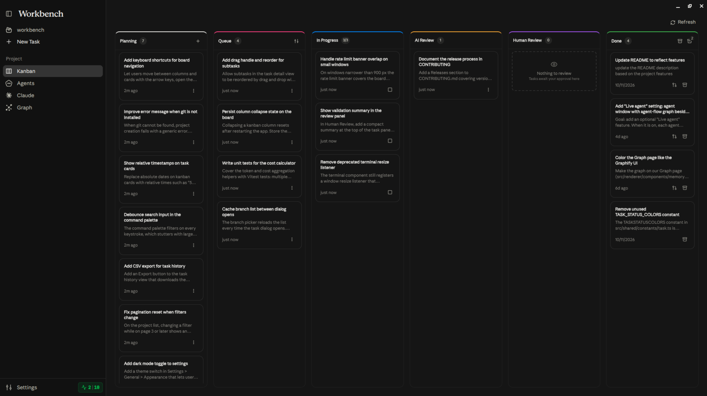
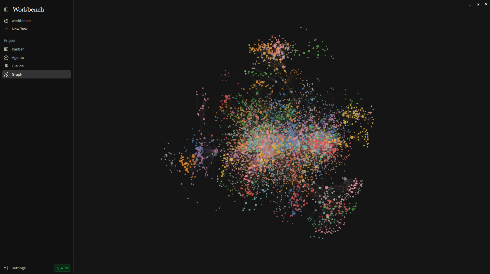
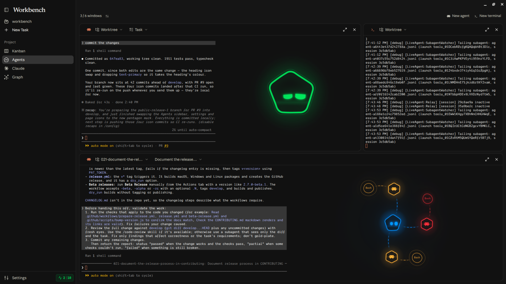

<p align="center">
  <picture class="github-only">
    <source media="(prefers-color-scheme: light)" srcset="./resources/assets/workbench-light.png">
    <source media="(prefers-color-scheme: dark)" srcset="./resources/assets/workbench-dark.png">
    
  </picture>
</p>

## What's new in this fork

This fork ([ianderse/workbench](https://github.com/ianderse/workbench), branch `omp-local-llm`) adds local-model support through OMP and a more autonomous task pipeline. Upstream Workbench is described below the changelog. Entries are dated so changes can be tracked; commit hashes point at the change.

### 2026-10-24

**Local models with OMP**
- OMP (oh-my-pi) as a second agent backend next to Claude Code: tasks, triage, Insights chat, one-off calls and agent windows run through `omp` and your local models. OMP output is translated into Claude Code's stream format, so logs, cost tracking and edited-file tracking keep working (`f065c12`, `294f99d`, `b4ea5ba`, `434fc74`)
- The UI names the backend in use instead of always saying Claude, Claude-only settings are hidden under OMP, and the Chat page lists your OMP models (`59b186b`, `3b81e81`, `fdbcf7b`, `cce5ada`)
- Self-improve memories reach OMP runs (`229bc66`)
- OMP picks a model role per job: planning uses your `plan` role, implementing and validating use `default`, the fresh-eyes review uses `judge`. Workbench size mappings and per-task pins still win (`7c689d8`)
- Log lines name the model that actually runs, and the triage summary names the size instead of a Claude model (`a3afc13`, `12da35b`)
- Claude usage polling pauses while OMP is selected (`0a3f233`)

**Reliability on slow or busy local servers**
- One ticket can use several model-server slots: independent parts run as parallel OMP subagents, capped by "Subagents per task" (default 3) (`d6059b9`)
- Longer time limits for OMP one-off calls (`7d28e5f`)
- Temporary failures (stalled streams, connection resets, 5xx, 429, "model is busy") are retried on the local model with growing waits (30s up to 10m, 5 retries by default). OMP's own fallback to other models stays off until those retries fail, and only if "Allow fallback models" is on (`c5836d4`, `e73570c`, `7c689d8`)
- "Model is writing… ~N tokens" progress lines during long replies (`c5836d4`)
- Tool names OMP accepts, and CLAUDE.md written without Claude Code's `/init` (`6e0e175`)

**Task pipeline**
- "What was done" panel at the top of tickets in Human Review: the agent's summary, AI review verdict, check results, open findings by severity, files changed with +/- counts, and time, cost and models. The original request below it is collapsed
- Break into tasks: one model run turns a big prompt or spec into 2 to 12 dependent tickets you review before they're created. Queued tickets wait for the tickets they depend on (`c44a11a`)
- Pin the model, effort and backend per task, for example Opus 5.5 for one ticket while the rest run locally (`3dda352`)
- AI review loop: a task that fails review goes back to In Progress to fix its blocker and major findings, up to 3 rounds by default. If it still fails, Human Review shows why, the open findings and what each round fixed (`999720f`)
- Triage that fails plans the task instead of skipping planning (`c5836d4`)
- Starting tasks get a "Since this ticket was written" briefing on merged work. After each merge, queued tickets get context notes and proposals for obsolete, duplicate or follow-up tickets (`4144b4c`)
- Resume continues a stopped or failed task in the same session and worktree. Retry is now Start over, asks first, and backs up all work to a `workbench/backup/...` branch before discarding anything (`24012b0`)
- Autonomous mode (per project): tasks that pass AI review merge on their own into `workbench/auto` (or `main`), get pushed, and unblock the tasks waiting on them. You still review merged tasks and move them to Done, with Revert and Merge into main actions (`c610f26`)
- Tickets can split themselves: when planning finds a ticket far too large, or implementing leaves work out on purpose (a `## Deferred` list), the agent moves that scope into 1 to 4 new tickets at the top of the Queue, chained after the original. Tickets that waited on the original now wait for the last piece. The setting "Split large tickets" (Off, Propose, Auto) is per project; Propose pauses the task after planning until you apply or dismiss the split, Auto applies it with an undo entry in Queue updates

**Insight**
- Usage page (sidebar): per-project token usage from a new `.workbench/usage.jsonl` ledger. Total tokens split into input, output and cache, local versus cloud share with the cloud bill you didn't pay (local tokens priced as Sonnet 5.5 at list rates), by model with tokens per second, by job, top tasks, the last 30 days and a few fun facts. Every OMP and Claude Code run is recorded per model, and "Rebuild from history" imports what earlier tasks spent from their session files

**Fixes**
- Autonomous mode skipped the merge of a task that had just passed AI review, because the verdict reached disk after the merge check read it. The verdict is now written first, and tasks left unmerged by this are merged when the app starts (`aa2137d`)
- Workbench's own commits never include `node_modules`, virtual environments or root build output, even without a `.gitignore` (`19b90a1`)

---

**Workbench is a desktop app based on the Claude Code harness, built for proactive engineers.** It gives you a space to manage your project tasks and hand each one to an agent that works in its own git worktree, so your main branch stays untouched until you review and merge. Every task starts with a short triage run that efficiently picks the model and the thinking effort based on the task description, and decides whether the work needs planning, so a one-line fix doesn't burn an Opus run and a refactor across a dozen files doesn't get handed to Haiku. From there, the same session plans, implements, runs your project's checks, reviews its own diff with fresh eyes, and commits, while parallel tasks are told which files the other unmerged branches touch so they stay out of each other's way.

<p align="center">
  <picture class="github-only">
    <source media="(prefers-color-scheme: light)" srcset="./resources/assets/kanban-light.png">
    <source media="(prefers-color-scheme: dark)" srcset="./resources/assets/kanban-dark.png">
    
  </picture>
</p>

Workbench also improves over time by learning and retaining preferences from your sessions, enabling a built-in compounding engineering workflow. You become the manager/architect of your project, setting the direction and priorities while the agents do the work. Nothing lands until you have reviewed it, and you always know what the result costs.

<p align="center">
  <picture class="github-only">
    <source media="(prefers-color-scheme: light)" srcset="./resources/assets/graph-light.png">
    <source media="(prefers-color-scheme: dark)" srcset="./resources/assets/graph-dark.png">
    
  </picture>
</p>

## Motivation

Every creative builder has a graveyard of ideas. Each idea wants an evening you don't have, and the ones you start stall where the interesting part ends, and the plumbing begins. The agent in your terminal can do that plumbing today, but you still sit with it one session at a time: one idea, one branch, one window, until the context runs out. Workbench closes that gap by turning your ideas into projects and your projects into a board of tasks the agents build in parallel, so they end up in review instead of buried.

<p align="center">
  <picture class="github-only">
    <source media="(prefers-color-scheme: light)" srcset="./resources/assets/agents-light.png">
    <source media="(prefers-color-scheme: dark)" srcset="./resources/assets/agents-dark.png">
    
  </picture>
</p>

Most tools in this space write their own agent harness, and none of them outperforms the one you already have installed. You see it in the results: a loop that plans worse, retries more, and spends more than Claude Code does on the same task. So why build another harness when one already works? Workbench runs on Claude Code rather than competing with it, using the same CLI with your own accounts, subagents, skills, and MCP servers, and spending its own effort on everything around the session instead.

## Local LLMs with OMP

Besides Claude Code, Workbench can run tasks, triage, Insights and agent windows through [OMP](https://github.com/can1357/oh-my-pi) (`omp`), which drives local models.

1. Install OMP (for example `brew install can1357/tap/omp`) and check that `omp --version` works.
2. Add your local server to `~/.omp/agent/models.yml`. Ollama example:

   ```yaml
   providers:
     ollama:
       baseUrl: http://localhost:11434/v1
       api: openai-completions
       apiKey: ollama
       discovery:
         type: openai-models-list
   ```

   LM Studio, llama.cpp, MLX and other OpenAI-compatible servers work the same way with their own `baseUrl`. Run `omp models` to confirm the models show up.
3. Set OMP's model roles in `~/.omp/agent/config.yml` (`modelRoles`). Workbench uses `plan` for planning, `default` for implementing, validating and one-off calls, and `judge` for the fresh-eyes review. Roles you don't define fall back to `default`. Cloud models work too once you've signed in with `omp login`.
4. In Settings > Agents, set Agent backend to OMP (local models). Workbench detects the CLI and lists its models. Mapping the four sizes (Small to Largest) is optional and overrides the roles; you can also pin a model on a single task.
5. Optional: set "Retries on the local model" and "Allow fallback models" for how busy or flaky servers are handled.

Limitations with OMP: MCP connectors from Workbench, Claude accounts and account switching, usage and rate limit tracking, and budgets do not apply. Configure MCP servers in OMP itself (`~/.omp/agent/mcp.json` or a project `.mcp.json`). Agent windows start `omp` with `--auto-approve` when permissions are skipped.

## Contribute

Pull requests are temporarily not accepted, but every other kind of contribution is welcome. If something looks broken or missing, open an [issue](https://github.com/proactive-agent/workbench/issues) describing what you expected to happen instead. Ideas, questions, and features you would like to see belong in [discussions](https://github.com/proactive-agent/workbench/discussions), where they can be argued over before implementation.

## License

Copyright (C) 2026 Artyom Vancyan. [MIT](./LICENSE)
